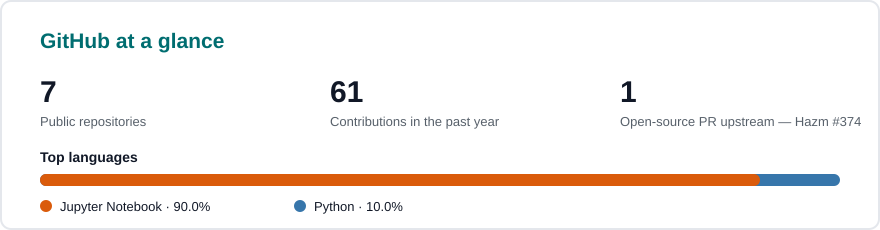

  

**جستجو را به رشد تبدیل می‌کنم — سیستم‌های سئو که رتبه می‌گیرند، گردش‌کارهای هوش مصنوعی که مقیاس می‌شوند و محصولاتی که از طریق جستجو مشتری پیدا می‌کنند.**

سئو تکنیکال · GEO / جستجوی هوش مصنوعی · سئوی برنامه‌ای (Programmatic SEO) · موتورهای محتوای هوش مصنوعی · رشد محصول‌محور · پردازش زبان طبیعی فارسی

  

---

## چه چیزی می‌سازم

- **سیستم‌های سئو و GEO.** ممیزی تکنیکال، صفحات برنامه‌ای، موتورهای لینک‌سازی داخلی و دیده‌شدن در جستجوی هوش مصنوعی — اندازه‌گیری‌شده در سرچ کنسول، نه حسی. مدیر سئو و مدیر محصول در [بن‌باما](https://bonbama.ir).

- **موتورهای رشد با هوش مصنوعی.** گردش‌کارهای سئو × هوش مصنوعی برای تحقیق، بریف و انتشار در مقیاس — با تایید انسانی قبل از اینکه چیزی منتشر شود.

- **محصولاتی که مردم از طریق جستجو پیدا می‌کنند.** بن‌باما (کشف و مارکت‌پلیس محلی) و [آلمانی‌باما](https://almanibama.ir) — پلتفرم یادگیری آلمانی برای فارسی‌زبان‌ها، با دیکشنری، محتوای آمادگی آزمون و کتابخانه خودش.

- **پردازش زبان طبیعی فارسی، سرتاسری.** خزیدن، پیش‌پردازش با Hazm، امبدینگ و مدل‌های یادگیری عمیق برای متن فارسی — پروژه‌های منتخب را پایین ببینید.

- **در ملأ عام.** بیش از ۱۸٫۴ هزار دنبال‌کننده در [لینکدین](https://www.linkedin.com/in/mohammad-abbasi-sh/)، مستندسازی آزمایش‌های واقعی سئو / هوش مصنوعی در مسیر ۱۰۰ هزار نفر.

**توانایی‌ها، و مدرک‌شان**

| توانایی | مدرک |
| --- | --- |
| سئوی تکنیکال و برنامه‌ای (کرول، اسکیما، سایت‌مپ، API سرچ کنسول) | [Bonbama](https://bonbama.ir) · [LinkedIn](https://www.linkedin.com/in/mohammad-abbasi-sh/) |
| GEO / دیده‌شدن در جستجوی هوش مصنوعی و سیستم‌های محتوای هوش مصنوعی | [LinkedIn — SEO × AI](https://www.linkedin.com/in/mohammad-abbasi-sh/) |
| پردازش زبان طبیعی فارسی و یادگیری عمیق (BiLSTM، Word2Vec، Hazm) | [persian-sentiment-analysis](https://github.com/mohammad-abbasi-sh/persian-sentiment-analysis) |
| مدل‌سازی دنباله (LSTM، پیش‌بینی سری زمانی) | [traffic-state-prediction-lstm](https://github.com/mohammad-abbasi-sh/traffic-state-prediction-lstm) |
| توسعه وب (فرانت‌اند، جاوااسکریپت / تایپ‌اسکریپت، ری‌اکت) | فرانت‌اند ۲۰۱۸ تا ۲۰۲۳ · سئوی GiftPals در ۲۰۲۳ تا ۲۰۲۵ · مدیر داده و هوش مصنوعی، ROBOTITAN در ۲۰۲۵ |
| محصول و رشد (مارکت‌پلیس، سئوی محلی، محصولات آموزشی) | [Bonbama](https://bonbama.ir) · [Almanibama](https://almanibama.ir) |

---

## پروژه‌های منتخب

| پروژه | پروژه |
| --- | --- |
| **[تحلیل احساسات فارسی](https://github.com/mohammad-abbasi-sh/persian-sentiment-analysis)** دسته‌بندی احساسات فارسی سرتاسری روی **بیش از ۲۳٬۰۰۰ نظر دیجی‌کالا** — خزنده اختصاصی، پیش‌پردازش Hazm، Word2Vec و یک LSTM دوسویه با **دقت تست ۸۹ تا ۹۰٪**.  **Python · TensorFlow / Keras · Word2Vec · Hazm · Jupyter** | **[پیش‌بینی وضعیت ترافیک — LSTM](https://github.com/mohammad-abbasi-sh/traffic-state-prediction-lstm)** پیش‌بینی وضعیت بعدی ترافیک در تقاطع‌ها با شبکه‌های LSTM روی‌هم‌چیده، قدمی به سمت کنترل تطبیقی چراغ راهنمایی. سه صورت‌بندی آزموده شد: فقط وضعیت، وضعیت+عمل، و دسته‌بندی عمل بعدی.  **Python · LSTM · scikit-learn · Time Series** |
| **[بن‌باما](https://bonbama.ir)** — *محصول، کد خصوصی* کشف و مارکت‌پلیس محلی که در آن سئو و محصول را هدایت می‌کنم: صفحات محلی برنامه‌ای، جذب کسب‌وکار و یک اسپرینت رشد که با رزرو واقعی اندازه گرفته می‌شود، نه فقط ترافیک.  **سئو · محصول · جستجوی محلی · مارکت‌پلیس** | **[آلمانی‌باما](https://almanibama.ir)** — *محصول، کد خصوصی* پلتفرم یادگیری آلمانی برای فارسی‌زبان‌ها که بنیان‌گذار و سازنده‌اش هستم: دیکشنری بیش از ۴٬۰۰۰ کلمه، آمادگی آزمون Goethe / telc و یک کتابخانه محتوای در حال رشد.  **محصول · EdTech · محتوا · سئو** |
| **[seo-audit-cli](https://github.com/mohammad-abbasi-sh/seo-audit-cli)** — *هفته اول از ۱۲* ممیزی تکنیکال سئو بدون وابستگی برای هر URL: چک‌های title، meta، H1، canonical، اسکیما و OG با امتیاز ۰ تا ۱۰۰. یک دستور، بدون نصب.  **Python · سئوی تکنیکال · CLI** | **۱۲ پروژه در ۱۲ هفته** هر هفته یک پروژه واقعی سئو × هوش مصنوعی، ساخته و منتشرشده همین‌جا — بدون دمو، بدون پرکننده. در [لینکدین](https://www.linkedin.com/in/mohammad-abbasi-sh/) دنبال کنید.  **ساخت در ملأ عام · سئو × هوش مصنوعی** |

---

## آمار گیت‌هاب

  

### 🕹️ آرکید کامیت

کامیت‌های سال گذشته‌ام به شکل یک بازی پک‌من، که روزانه با GitHub Actions بازسازی می‌شود. ساخته‌شده با [pacman-contribution-graph](https://github.com/abozanona/pacman-contribution-graph)

---

[LinkedIn](https://www.linkedin.com/in/mohammad-abbasi-sh/) · [Bonbama](https://bonbama.ir) · [Almanibama](https://almanibama.ir)

